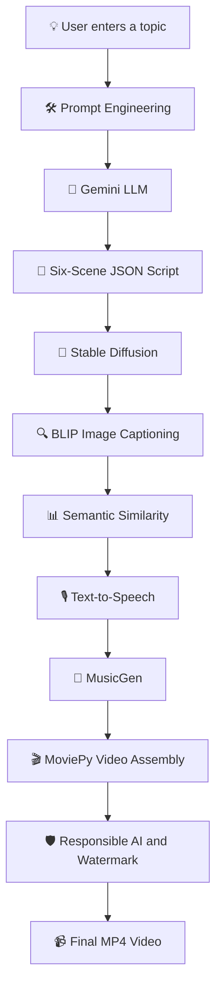

<div align="center">

# MIT ART, DESIGN AND TECHNOLOGY UNIVERSITY
**MIT SCHOOL OF COMPUTING, PUNE**  
*Department of Computer Science and Engineering*

---

**GENERATIVE AI · LLM MINI-PROJECT (P36)** · Academic Year 2026–2027

# 🎬 Script2Video AI
### Script-to-Narrated Video Maker

**Transform any topic into a 30–60 second AI-generated narrated video using Large Language Models, image generation, audio synthesis and video processing.**


| | |
|---|---|
| **Project Number** | P36 |
| **Project Title** | Script-to-Narrated Video Maker |
| **Application Name** | Script2Video AI |
| **Submitted By** | Pratik Gholap |
  **Roll No** | 36 |
| **Enrolment Number** | [ADT23SOCB0792] |
| **Division** | [AIA-3] |
| **Course** | Generative AI |
| **Academic Year** | 2026–2027 |
| **University** | MIT Art, Design and Technology University |

</div>

---

## 📖 What is Script2Video AI?

Creating a narrated video traditionally requires multiple steps, including scriptwriting, visual design, voice recording, background music selection and video editing.

**Script2Video AI** simplifies this process by using Generative AI models to transform a user-provided topic into a short narrated video.

The user enters a topic, selects a prompting technique and generates a structured six-scene script using Google's Gemini LLM.

The application is designed to produce:

- 📝 A **six-scene video script** using Google Gemini.
- 🎨 **AI-generated scene images** using Stable Diffusion.
- 🔍 **Image caption verification** using BLIP.
- 📊 **Semantic similarity scores** using Sentence Transformers.
- 🎙️ **Narration audio** using Text-to-Speech.
- 🎵 **AI-generated background music** using MusicGen.
- 🎬 A **30–60 second MP4 video** assembled using MoviePy.
- 🏷️ An **AI-generated disclosure label and watermark** for responsible AI usage.

The goal is to integrate multiple Generative AI technologies into one application.

---

## 🎥 Demo

**Project output:** A narrated video generated from a user-provided topic.

<div align="center">

<!-- Add your final video preview or GIF here after U4 is completed -->

`[Add final_video.mp4 preview or sample GIF here]`

**Live Application:** [Add your deployed Streamlit application URL]

**GitHub Repository:** [Script2Video AI](https://github.com/Pratik5400/Script2Video_AI)

</div>


## ⚙️ How It Works

The application follows a multi-stage Generative AI workflow.

### System Architecture



### Workflow Explanation

| Step | Process | Technology |
|---|---|---|
| 1 | User enters a topic and selects a prompting technique | Streamlit |
| 2 | Prompt templates are constructed using zero-shot or few-shot prompting | Python |
| 3 | A six-scene video script is generated | Google Gemini |
| 4 | Scene descriptions and image prompts are extracted from JSON | Python |
| 5 | Six images are generated based on the scene prompts | Stable Diffusion |
| 6 | Generated images are automatically described | BLIP |
| 7 | Expected descriptions and captions are compared | Sentence Transformers |
| 8 | Narration audio is generated | Text-to-Speech |
| 9 | Background instrumental music is generated | MusicGen |
| 10 | Images, narration and music are combined | MoviePy |
| 11 | AI-generated disclosure and watermark are applied | Python / MoviePy |
| 12 | Final video is exported | MP4 / H.264 |

---

## 🎓 How It Covers the Five Course Units

This project addresses all five units of the Generative AI mini-project curriculum.

| Unit | Task | Implementation |
|---|---|---|
| **U1** | Write scene-prompt templates | Zero-shot and few-shot prompt engineering |
| **U2** | Generate a six-scene script using an LLM | Gemini-based structured JSON generation |
| **U3** | Generate scene images and verify with BLIP | Stable Diffusion, BLIP and semantic similarity |
| **U4** | Add narration, music and assemble video | TTS, MusicGen and MoviePy |
| **U5** | Responsible AI and watermarking | AI disclosure, safety guardrails, bias and hallucination evaluation |

### Generative AI Concepts Covered

| Course Layer | Concepts |
|---|---|
| Foundations | Generative vs discriminative AI, lifecycle and prompt engineering |
| GANs and LLMs | Transformer architecture, attention and LLM generation |
| GPT, BERT and Multimodal | GPT-style generation, BERT-family models and image understanding |
| Tools and Generation | Diffusion models, TTS, MusicGen and video generation |
| Responsible AI | Safety, transparency, hallucination, bias and licensing |

---

## ✨ Key Features

### 1. Prompt Engineering
- Zero-shot prompting.
- Few-shot prompting.
- Structured scene-prompt templates.
- Comparison of prompting techniques.

### 2. LLM-Based Script Generation
- Gemini-powered script generation.
- Six-scene structured output.
- Scene-wise narration.
- Visual descriptions and image prompts.
- JSON-based output handling.

### 3. AI Image Generation
- Stable Diffusion-based image generation.
- One image for every scene.
- Google Colab GPU-based execution.
- Automated image saving and retrieval.

### 4. Image Caption Verification
- BLIP image caption generation.
- Expected description comparison.
- Sentence Transformers-based semantic similarity.
- Identification of potentially mismatched images.

### 5. Audio and Video Generation
- Text-to-Speech narration.
- MusicGen background music.
- MoviePy video assembly.
- Scene synchronization and transitions.
- MP4 export.

### 6. Responsible AI
- AI-generated content disclosure.
- Visible video watermark.
- Safety guardrails.
- Hallucination and bias evaluation.
- Model documentation and licence information.

---

## 📊 Results and Evaluation

The project evaluates the generated output at different stages.

| Evaluation Area | Measurement |
|---|---|
| Script Generation | Six-scene JSON structure validation |
| Prompt Engineering | Zero-shot vs few-shot comparison |
| Image Generation | Number of successfully generated images |
| Image Verification | BLIP captions and cosine similarity |
| Narration | Generated audio and duration |
| Background Music | Music generation and playback |
| Video Assembly | Final MP4 duration and playback |
| Responsible AI | Safety, bias and hallucination test results |

### Image Verification

The system compares the expected visual description with the caption generated by BLIP.

The similarity score is calculated using Sentence Transformers and cosine similarity.

<!-- Add actual verification results after running U3 -->

| Scene | Expected Description | BLIP Caption | Similarity |
|---|---|---|---|
| Scene 1 | [Actual description] | [Actual caption] | [Actual score] |
| Scene 2 | [Actual description] | [Actual caption] | [Actual score] |
| Scene 3 | [Actual description] | [Actual caption] | [Actual score] |

### Final Video Evaluation

| Parameter | Result |
|---|---|
| Number of Scenes | 6 |
| Target Duration | 30–60 seconds |
| Video Format | MP4 |
| Video Resolution | [Actual resolution] |
| Narration | [Actual result] |
| Background Music | [Actual result] |
| AI Watermark | [Actual result] |
| Video Playback | [Actual result] |

### Failure Case

Potential failure cases evaluated during development include:

- Generated images not matching their scene descriptions.
- BLIP producing incomplete or incorrect captions.
- Image generation failing because of insufficient GPU resources.
- TTS generation or audio synchronization failures.
- Video rendering errors caused by missing files or incompatible formats.

Document the actual failure encountered, its cause and corrective action after testing.

---

## 🛠️ Technology Stack

| Component | Technology | Purpose |
|---|---|---|
| Programming Language | Python | Main development language |
| Web Interface | Streamlit | Interactive application |
| LLM | Google Gemini | Six-scene script generation |
| Prompt Engineering | Python | Zero-shot and few-shot prompting |
| Image Generation | Stable Diffusion 1.5 | Scene image generation |
| Image Framework | Hugging Face Diffusers | Diffusion pipeline |
| Deep Learning | PyTorch | Model execution |
| Image Captioning | BLIP | Image understanding |
| Similarity Model | all-MiniLM-L6-v2 | Semantic comparison |
| Audio Generation | gTTS / selected TTS model | Narration |
| Music Generation | MusicGen | Background music |
| Video Processing | MoviePy | Video assembly |
| GPU Environment | Google Colab | Image and music generation |
| Development IDE | PyCharm | Project development |
| Version Control | Git and GitHub | Source code management |

---

## 🚀 Run the Project Locally

### Prerequisites

- Python 3.12 or a compatible version.
- PyCharm or another Python IDE.
- Git.
- Google Gemini API key.
- Internet connection.
- Google Colab account for GPU-based generation.

### 1. Clone the Repository

```bash
git clone https://github.com/Pratik5400/Script2Video_AI.git
```

Navigate to the project directory:

```bash
cd Script2Video_AI
```

### 2. Create a Virtual Environment

Windows:

```bash
python -m venv .venv
```

Activate it:

```powershell
.venv\Scripts\Activate.ps1
```

### 3. Install Dependencies

```bash
python -m pip install --upgrade pip
pip install -r requirements.txt
```

### 4. Configure Environment Variables

Create a `.env` file in the root directory.

Copy the example configuration:

```powershell
copy .env.example .env
```

Add your API credentials:

```env
GEMINI_API_KEY=your_gemini_api_key_here
HF_TOKEN=your_huggingface_token_here
```

Only add the variables required by your actual implementation.

Get a Gemini API key:

https://aistudio.google.com/app/apikey

Get a Hugging Face token if required:

https://huggingface.co/settings/tokens

**Security:** Never upload `.env` or real API keys to GitHub. Use environment variables or deployment secrets.

### 5. Run the Application

```bash
streamlit run app.py
```

Open:

```text
http://localhost:8501
```

### 6. Generate a Video

1. Enter a topic.
2. Select Zero-shot or Few-shot prompting.
3. Generate the six-scene script.
4. Generate or import the six scene images.
5. Run BLIP caption verification.
6. Generate narration.
7. Generate or import background music.
8. Assemble the final video.
9. Download the generated MP4.

---

## ☁️ Google Colab Integration

Google Colab is used for GPU-intensive model execution.

### U3 – Image Generation and BLIP

Notebook:

`notebooks/P36_U3_Image_Generation_BLIP.ipynb`

Tasks:

- Load the six-scene JSON.
- Load Stable Diffusion.
- Generate scene images.
- Load BLIP.
- Generate image captions.
- Calculate semantic similarity.
- Export images and verification results.

### U4 – Music Generation

Notebook:

`notebooks/P36_U4_MusicGen.ipynb`

Tasks:

- Load MusicGen.
- Generate instrumental background music.
- Save the generated audio.
- Export the soundtrack for local video assembly.

*Google Colab GPU availability and usage limits depend on the account and current resource availability.*

---

## 📁 Project Structure

```text
PS36_PratikGholap/
│
├── app.py
├── prompts.py
├── llm_service.py
├── image_service.py
├── blip_service.py
├── audio_service.py
├── video_service.py
├── responsible_ai.py
│
├── requirements.txt
├── README.md
├── MODEL_CARD.md
├── .env.example
├── .gitignore
│
├── assets/
│   └── music/
│
├── generated/
│   ├── images/
│   ├── audio/
│   ├── videos/
│   └── video_script.json
│
├── notebooks/
│   ├── P36_U3_Image_Generation_BLIP.ipynb
│   └── P36_U4_MusicGen.ipynb
│
└── docs/
    └── screenshots/
```

*This is the intended project structure. Refer to the actual repository for the current list of implemented files.*

### Important Files

| File | Description |
|---|---|
| `app.py` | Main Streamlit application |
| `prompts.py` | Scene prompt templates |
| `llm_service.py` | Gemini integration |
| `image_service.py` | Scene image processing |
| `blip_service.py` | Image caption verification |
| `audio_service.py` | Text-to-Speech and audio processing |
| `video_service.py` | Video assembly and MP4 export |
| `responsible_ai.py` | Responsible AI features |
| `requirements.txt` | Python dependencies |
| `MODEL_CARD.md` | Model details and limitations |

---

## 🛡️ Responsible AI

Responsible AI is an important part of Script2Video AI.

The application is designed to incorporate:

1. **Content Safety:** Evaluate user topics and generated content for potentially harmful or inappropriate material.
2. **Image Verification:** Use BLIP captions and semantic similarity to identify images that may not match the intended scene.
3. **Transparency:** Add a visible AI-generated disclosure to the final video.
4. **Human Oversight:** Allow manual review of generated scenes and flagged results.
5. **Copyright Awareness:** Document model licences, attribution requirements and restrictions.
6. **Model Documentation:** Maintain a model card describing intended use, limitations and evaluation.

The generated content should not be treated as automatically factually accurate. Human review is necessary before publication.

---

## ⚠️ Limitations and Future Enhancements

### Current Limitations

- Image generation may require significant GPU resources.
- Visual consistency between different scenes may vary.
- BLIP captions may not capture every detail of an image.
- Semantic similarity is an approximate measure, not proof of visual correctness.
- Music and narration synchronization may require adjustments.
- Free-tier API and GPU availability may be limited.

### Future Enhancements

- Better character and visual consistency.
- Automatic regeneration of mismatched images.
- Multiple narration voices and languages.
- More advanced scene transitions.
- Automatic music synchronization.
- Longer video generation.
- Improved factual verification.
- Cloud-based deployment with scalable inference.

---

## 📜 Model Licences and Attribution

The project uses or plans to use the following models and tools. Verify the exact checkpoint and applicable licence before redistribution.

| Component | Model / Tool | Licence Information |
|---|---|---|
| LLM | Google Gemini | Refer to Google's applicable terms |
| Image Generation | Stable Diffusion 1.5 | Check the selected model card |
| Image Captioning | Salesforce BLIP | Check model repository licence |
| Semantic Similarity | all-MiniLM-L6-v2 | Apache 2.0 |
| Music Generation | Meta MusicGen | Check model licence and usage terms |
| TTS | Selected TTS engine | Check the selected engine licence |
| Video Processing | MoviePy | MIT |

---

## 🙏 Acknowledgements

I would like to acknowledge the guidance provided by the Department of Computer Science and Engineering, MIT School of Computing, MIT Art, Design and Technology University.

I also acknowledge the developers and research teams behind Google Gemini, Stability AI, Hugging Face, Salesforce BLIP, Sentence Transformers, Meta MusicGen, PyTorch, Streamlit and MoviePy.

---

<div align="center">

### 🎬 Script2Video AI

**From a simple idea to an AI-generated narrated video.**

Developed by **Pratik Gholap**

MIT Art, Design and Technology University, Pune

*Generative AI Mini-Project · P36 · 2026–2027*

</div>
