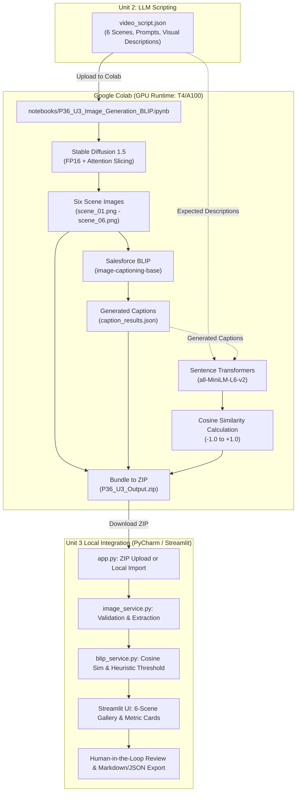

# P36: Script2Video AI — Unit 3 Technical Documentation
## AI Image Generation & BLIP Caption Verification Pipeline

---

## 1. Executive Overview

Unit 3 (U3) of the **Script2Video AI** system transforms structured scene prompts produced by Unit 2 into visual assets and rigorously validates their semantic alignment.

Because local Windows development environments in PyCharm may lack dedicated high-VRAM CUDA accelerators, the architecture decouples:
- **Heavy GPU Execution (Google Colab):** Diffusers Stable Diffusion 1.5 (`stable-diffusion-v1-5/stable-diffusion-v1-5`), Salesforce BLIP captioning (`Salesforce/blip-image-captioning-base`), and sentence embeddings (`sentence-transformers/all-MiniLM-L6-v2`).
- **Interactive Local Ingestion & Curation (PyCharm / Streamlit):** Archive extraction, structural integrity verification, visual gallery preview, real-time heuristic threshold tuning, human-in-the-loop manual review, and report export.

---

## 2. End-to-End Architecture



---

## 3. Google Colab Notebook Specification

- **File:** `notebooks/P36_U3_Image_Generation_BLIP.ipynb`
- **Hardware Requirement:** GPU Runtime (e.g. Free T4 on Google Colab).
- **Execution Flow:**
  1. **Cell 1:** Installs required packages (`diffusers`, `transformers`, `accelerate`, `sentence-transformers`, `pillow`, `torch`).
  2. **Cell 2:** Checks `torch.cuda.is_available()`, reports device name and available VRAM.
  3. **Cell 3:** Ingests `video_script.json` (via Colab file uploader or embedded default fallback).
  4. **Cell 4:** Loads `stable-diffusion-v1-5/stable-diffusion-v1-5` in FP16 with attention and VAE slicing memory optimizations.
  5. **Cell 5:** Loops through all 6 scenes, executes deterministic seeding (`BASE_SEED + scene_number`), handles individual scene failures with try/catch, and incorporates OOM auto-recovery (drops to 512x512 / 25 steps).
  6. **Cell 6:** Ingests generated images into `Salesforce/blip-image-captioning-base` to generate neutral visual captions.
  7. **Cell 7:** Encodes descriptions and captions using `sentence-transformers/all-MiniLM-L6-v2`, computes raw cosine similarity via `util.cos_sim()`, and flags initial heuristic status.
  8. **Cell 8:** Writes `generation_results.json`, `caption_results.json`, and `verification_results.json`.
  9. **Cell 9:** Archives files into `P36_U3_Output.zip` and triggers automatic browser download.

---

## 4. Verification Methodology & Metric Clarification

### Cosine Similarity Definition
Cosine similarity calculates the cosine of the angle between two multi-dimensional embedding vectors:

$$\text{Cosine Similarity}(\vec{u}, \vec{v}) = \frac{\vec{u} \cdot \vec{v}}{\|\vec{u}\|_2 \|\vec{v}\|_2}$$

- **Range:** `[-1.0, +1.0]`
- **Preservation of Raw Values:** Negative values are preserved as valid directional divergence. They are **never** clamped to positive numbers.
- **Distinction from Classification Accuracy:** Cosine similarity is a continuous semantic proximity metric in vector space. It is **not** classification accuracy or probability.

### Heuristic Threshold (Default: 0.40)
- The threshold is explicitly designated as an **exploratory heuristic** to assist human curators in triaging images for visual review.
- It does **not** represent a scientifically validated benchmark.
- Curators can interactively adjust the threshold in Streamlit (`0.00` to `1.00`).
- If score $\ge \text{threshold}$, status is `"Relevant"`. Otherwise, status is `"Needs Review (Heuristic)"`.

### Human-in-the-Loop Manual Review
Reviewers can manually override any scene's status directly in Streamlit:
- `Pending`
- `Approved (Manual)`
- `Flagged for Revision`
- `Rejected`
Reviewer notes are stored and included in exported verification reports.

---

## 5. Output Package Structure (`P36_U3_Output.zip`)

```
P36_U3_Output/
├── images/
│   ├── scene_01.png
│   ├── scene_02.png
│   ├── scene_03.png
│   ├── scene_04.png
│   ├── scene_05.png
│   └── scene_06.png
├── generation_results.json
├── caption_results.json
└── verification_results.json
```

---

## 6. Model Attribution & Licensing

| Model | Source Repository | Primary Role | License |
| :--- | :--- | :--- | :--- |
| **Stable Diffusion 1.5** | `stable-diffusion-v1-5/stable-diffusion-v1-5` | Text-to-Image Generation | [CreativeML OpenRAIL-M](https://huggingface.co/spaces/CompVis/stable-diffusion-license) |
| **Salesforce BLIP** | `Salesforce/blip-image-captioning-base` | Image-to-Text Captioning | [BSD-3-Clause](https://opensource.org/licenses/BSD-3-Clause) |
| **Sentence Transformers** | `sentence-transformers/all-MiniLM-L6-v2` | Dense Vector Embeddings | [Apache 2.0](https://www.apache.org/licenses/LICENSE-2.0) |
| **Gemini 3.8 Flash** | Google Generative AI | Structured Script Generation | Google Cloud Terms of Service |

---

## 7. Error Handling Matrix

| Failure Scenario | Component | Handled Behavior |
| :--- | :--- | :--- |
| **CUDA OOM on Colab** | `notebooks/...ipynb` | Clears PyTorch cache, retries at 512x512 resolution with 25 inference steps. |
| **Individual scene failure** | `notebooks/...ipynb` | Records failure status and error message in result record; continues remaining scenes without crashing. |
| **Corrupted / Empty Image** | `image_service.py` | PIL header inspection and pixel loading validation flags file as corrupted; surfaces warning in Streamlit. |
| **Missing Image from ZIP** | `image_service.py` | Marks scene as missing, flags "Needs Review (Missing)", shows placeholder card in UI. |
| **Invalid ZIP Archive** | `image_service.py` | Catches `zipfile.BadZipFile`, alerts user, prevents crash. |
| **Missing Script / Metadata** | `blip_service.py` | Reports structured error without crashing UI. |
